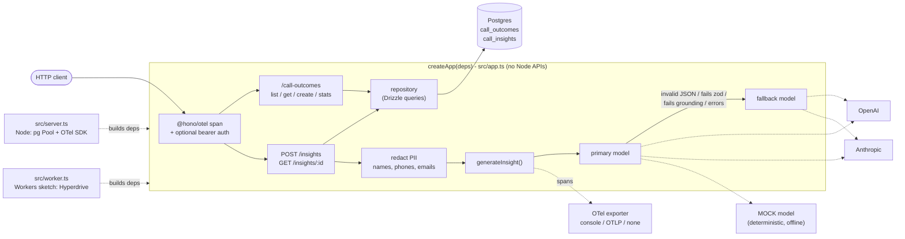

# voicedesk-insights-ts

A TypeScript port of one endpoint group from **VoiceDesk**, my Python (FastAPI) dashboard for AI phone agents.
In VoiceDesk every call an agent handles becomes a record (who called, why, what came of it) and
`GET /api/insights/{agent}` asks a model for a short operator brief. This service rebuilds that slice as a
standalone TypeScript API: call outcomes in Postgres, plus an insights endpoint that returns a **validated,
structured** insight instead of free text.

It is a portfolio project. It runs locally; it has not been deployed and has no users.

## Stack

| Concern | Choice |
| --- | --- |
| HTTP | [Hono](https://hono.dev) 4 on Node (`@hono/node-server`), runtime-agnostic app factory |
| Validation | zod 4 + `@hono/zod-validator` |
| Database | Postgres, Drizzle ORM 0.45 + drizzle-kit migrations, `pg` driver |
| AI | Vercel AI SDK 7 (`generateText` + `Output.object`), OpenAI and Anthropic providers |
| Tracing | OpenTelemetry: `@hono/otel` HTTP spans, custom attempt spans, AI SDK spans via `@ai-sdk/otel` |
| Tests | Vitest 5, PGlite (Postgres in WASM) or a real Postgres via `TEST_DATABASE_URL` |
| Tooling | TypeScript 6 strict, ESLint 10 + typescript-eslint (strict type-checked), GitHub Actions |

Node 22.12+ is required (Vitest 5's engine range).

## Architecture



`createApp()` takes its dependencies (a Drizzle `PgDatabase`, a model resolver, an optional API key) and
never touches `process`, a driver or the OTel SDK. `src/server.ts` wires those for Node; `src/worker.ts`
shows the same app on Cloudflare Workers.

## Endpoints

| Method | Path | What it does |
| --- | --- | --- |
| `GET` | `/health` | DB ping + AI mode. 200 ok, 503 if the DB is unreachable. Never needs auth. |
| `GET` | `/call-outcomes` | List, newest first. Filters: `agent`, `outcome` (substring), `q` (intent/summary search), `from`/`to` (ISO 8601). Pagination: `limit` (1-100, default 20), `offset`. Returns `{ data, pagination: { limit, offset, total } }`. |
| `GET` | `/call-outcomes/stats` | Port of VoiceDesk `db.stats()`: total, converted / open / informational, last 24h, per agent. Optional `agent`. |
| `GET` | `/call-outcomes/:id` | One record, 404 if missing. |
| `POST` | `/call-outcomes` | Create. Strict zod body (unknown keys rejected, so the API can't mark rows as sample data), 201 + `Location`. |
| `POST` | `/insights` | Body `{ agent?, callOutcomeIds?, limit? }`. Picks the records, redacts them, generates an insight, stores it, returns 201 with provider, model, `fallbackUsed`, `fallbackReason` and every attempt. 404 for unknown ids, 422 if nothing matches, 502 if every provider failed. |
| `GET` | `/insights/:id` | A stored insight. |

Validation errors are always `400 { error: "validation_failed", issues: [{ path, message }] }`.
If `API_KEY` is set, everything except `/health` needs `Authorization: Bearer <API_KEY>`.

The insight shape (`src/insights/schema.ts`):

```ts
{
  summary: string;                                   // 2-3 sentences
  topIntents: { intent: string; count: number }[];   // 1-5
  missedOpportunities: { callOutcomeId: number; reason: string }[];
  nextActions: { action: string; priority: 'high' | 'medium' | 'low' }[];  // 1-5
  sentiment: 'positive' | 'neutral' | 'negative' | 'mixed';
}
```

## Running it

```bash
npm install
cp .env.example .env                 # MOCK mode by default, no API keys needed

docker compose up -d postgres        # Postgres 17 on localhost:5432
npm run db:migrate                   # apply drizzle/ migrations
npm run db:seed                      # 23 SAMPLE call outcomes, flagged is_sample=true
npm run dev                          # http://localhost:8787, spans print to the console
```

```bash
curl localhost:8787/health
curl "localhost:8787/call-outcomes?agent=sales&limit=5"
curl -X POST localhost:8787/insights -H 'content-type: application/json' -d '{"agent":"receptionist"}'
curl -X POST localhost:8787/call-outcomes -H 'content-type: application/json' \
  -d '{"agent":"receptionist","intent":"Rent a 5x5","outcome":"Reserved 5x5"}'
```

See the fallback path without any API key: set `MOCK_PRIMARY_INVALID=true`, restart, and call
`POST /insights` again. The first (mock) model returns schema-invalid JSON, the response shows
`fallbackUsed: true, fallbackReason: "validation"` and the failed attempt.

Real providers: set `OPENAI_API_KEY` and/or `ANTHROPIC_API_KEY` (optionally `AI_PROVIDER`,
`AI_FALLBACK_PROVIDER`, `OPENAI_MODEL`, `ANTHROPIC_MODEL`). With both keys, the default is OpenAI first and
Anthropic as the fallback. Tracing to a collector: `OTEL_TRACES_EXPORTER=otlp` and
`OTEL_EXPORTER_OTLP_ENDPOINT=http://localhost:4318`.

Production-style run: `npm run build && npm start`.

### Checks

```bash
npm run lint
npm run typecheck
npm test                 # PGlite: no Docker, no network, no API keys
npm run test:coverage
docker compose up -d postgres-test && npm run test:pg   # same suite against real Postgres on :5433
```

## Design decisions

- **Structured output, then a grounding check.** The model's answer has to parse as JSON and match the zod
  schema (the AI SDK enforces that). A schema can't see the input, so `checkGrounding()` also rejects
  answers that cite a record id that wasn't sent, repeat an id, or count more intents than there were calls.
  Any of those counts as a validation failure.
- **Fallback on validation failure (and on provider errors).** Models are tried in order; the first answer
  that passes every check wins. The response and the stored row say which provider answered and why the
  fallback ran (`validation` vs `provider_error`), so a flaky provider is visible instead of silent.
- **MOCK mode is a real AI SDK model, not a bypass.** `createMockModel()` implements the provider
  interface (`LanguageModelV4`) and returns JSON computed by rules from the records. Requests in mock mode go
  through the same `generateText` → `Output.object` → zod → grounding path as real ones, so the tests cover
  the actual pipeline. Unit tests also use the SDK's `MockLanguageModelV4` to feed bad JSON, schema-breaking
  JSON, invented ids and API errors into the fallback logic.
- **Least privilege for the model.** Ported from VoiceDesk's `brief_rows()`: the model only gets
  `id, intent, outcome, summary`, with emails, phone numbers and the callers' own names replaced in the text.
  A test asserts that names, numbers and emails from the records never reach the prompt. AI SDK input recording
  is off in traces (`recordInputs: false`), and the HTTP span drops the query string.
- **Runtime-agnostic core.** Config is parsed from a plain env object; the DB type is Drizzle's
  driver-agnostic `PgDatabase`, so node-postgres (server), PGlite (tests) and a Workers driver all fit.
- **PGlite for tests instead of pg-mem.** Docker wasn't running on the machine this was built on. PGlite is
  real Postgres compiled to WASM, so the same SQL migrations run unchanged (identity columns, `jsonb`,
  descending indexes), which pg-mem only approximates. CI and `npm run test:pg` run the suite against a real
  Postgres too.
- **Sample data is labelled in the database.** Seeded rows have `is_sample = true`, fictional names,
  555-01xx numbers and `example.com` emails. Re-seeding replaces only sample rows, and the API can't create
  sample rows.
- **Insights are stored.** `call_insights` keeps the insight with provider, model, fallback info and the
  exact record ids it was built from.

## What's real and what's mock

| Real | Mock / not done |
| --- | --- |
| Hono API, zod validation, Drizzle schema + migrations, Postgres queries | Seed data is fake (`is_sample = true`) |
| OpenAI / Anthropic calls through the AI SDK when keys are set | **Not tested against live OpenAI/Anthropic APIs** in this repo; tests use fake models. Model ids are config defaults (`gpt-5.4-mini`, `claude-haiku-4-5`) and may need changing. |
| Fallback + grounding logic (tested with fake models that return bad output) | MOCK mode insight is rule-based, not AI |
| OpenTelemetry spans (a test captures them in memory and checks HTTP, attempt and AI SDK spans) | OTLP exporter configured but not tested against a live collector |
| Test suite passes on PGlite and on a real Postgres 14 | `docker-compose.yml` written but not run here (Docker daemon unavailable when built) |
| Node server built and smoke-tested with curl | `src/worker.ts` + `wrangler.toml` are a sketch: type-checked, never run on Workers. No OTel exporter on Workers. |
| GitHub Actions workflow file | CI has not run yet (repo not pushed) |

## Project layout

```
src/
  app.ts                 Hono app factory (runtime-agnostic)
  config.ts              env -> typed config, provider selection
  server.ts              Node entry
  worker.ts              Cloudflare Workers entry (sketch)
  db/                    schema, repository, migrate + seed scripts, sample data
  insights/              schema, redaction, prompt, mock model, providers, generate + fallback
  routes/                call-outcomes, insights
  telemetry/node.ts      tracer provider + exporter selection
drizzle/                 SQL migrations (drizzle-kit)
test/unit, test/api      Vitest
```
